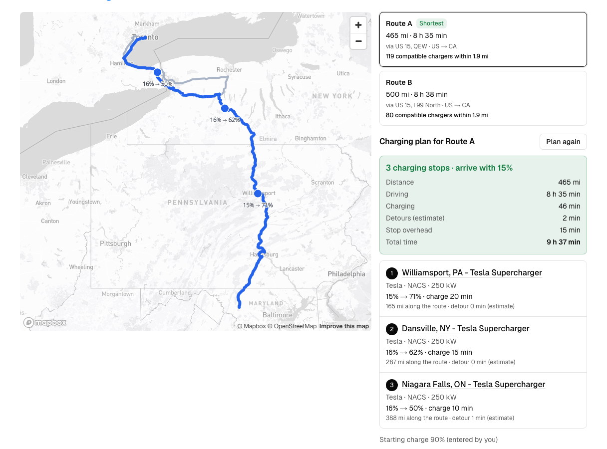
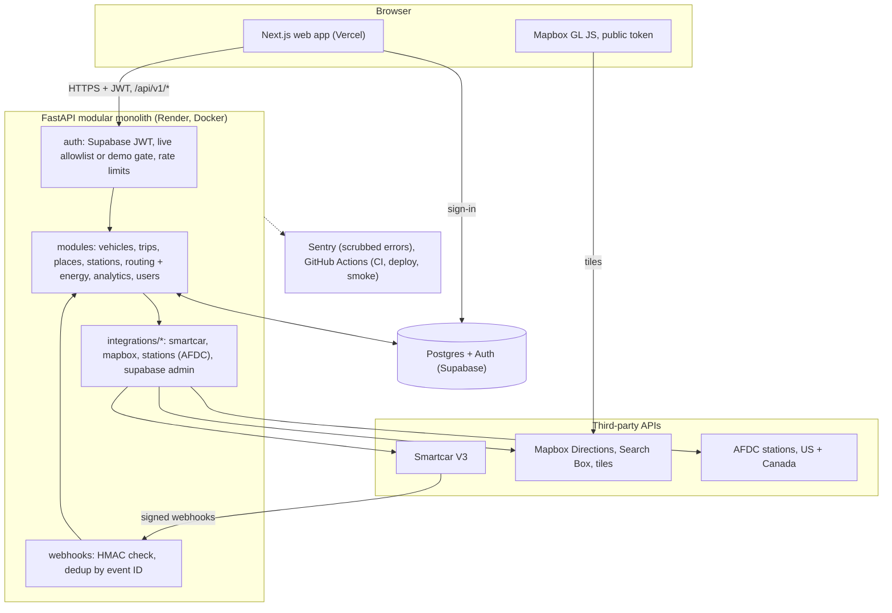
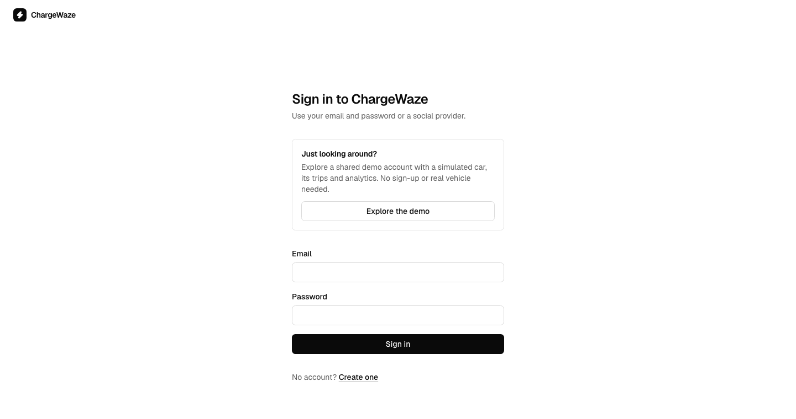
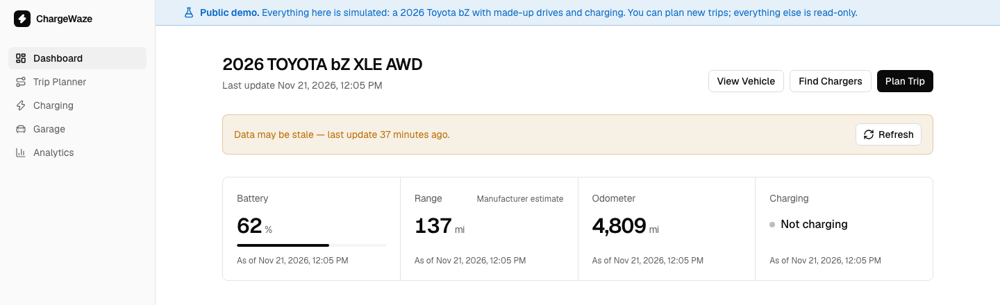
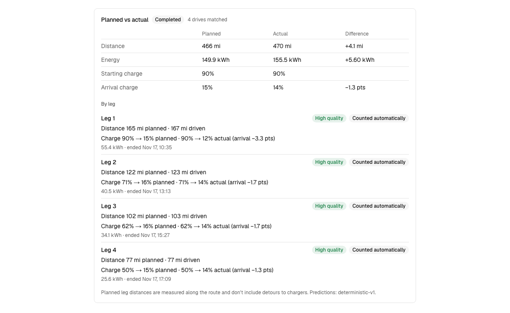
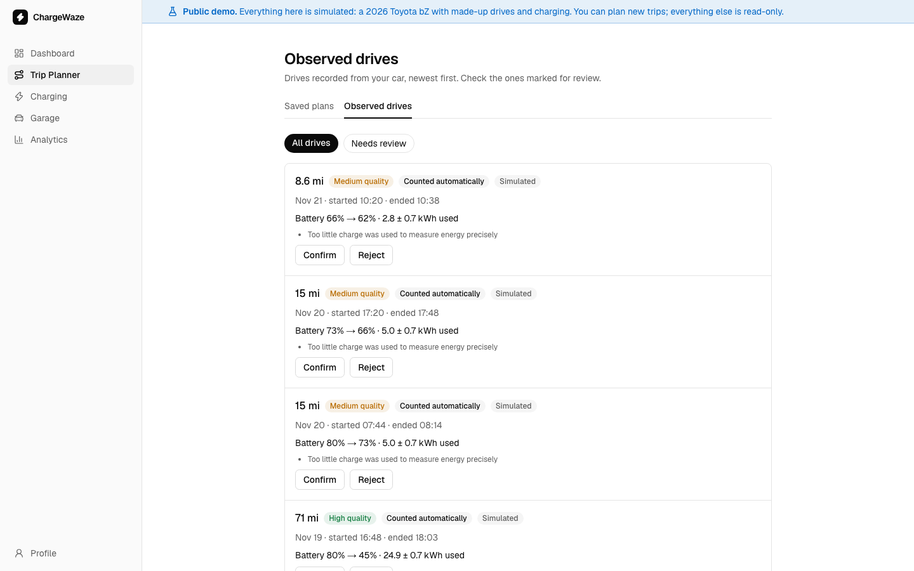
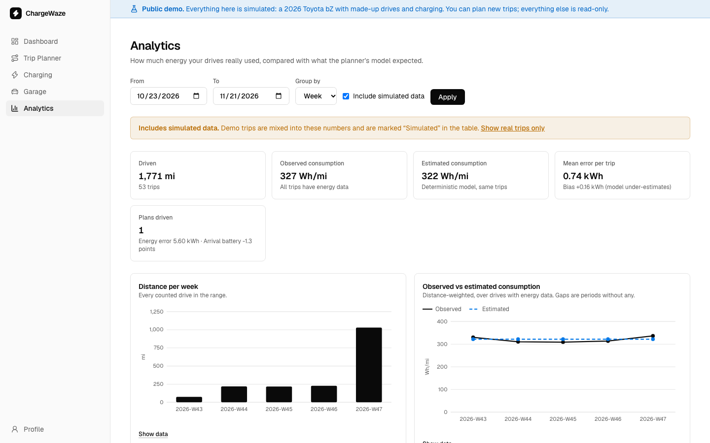

# ChargeWaze

ChargeWaze is a full-stack EV route planner and vehicle-analytics app. It reads a car's battery state from Smartcar V3, draws driving routes with Mapbox, and finds charging stations through the AFDC API (US and Canada). Its own optimizer then answers one question:

> Given my car's current charge and where I want to go, which charging stops get me there fastest without dropping below my reserve, or why can't I get there at all?

Once you've driven, ChargeWaze compares what it predicted with what the car reported.

**Live:** [chargewaze.vercel.app](https://chargewaze.vercel.app). Sign-in is limited to an allowlist, because the production app holds real vehicle data. A public demo with simulated data is described in [`docs/demo-script.md`](docs/demo-script.md); its URL is pending (see [Status](#status)).



## What it does

| Page | What you get |
|---|---|
| **Dashboard** | The car's latest battery level, range, odometer and charging state, each with the time it was recorded. Stale readings are marked, and **Refresh** fills gaps when webhooks were missed ([ADR 0010](docs/adr/0010-on-demand-vehicle-refresh.md)). |
| **Trip Planner** | Search an origin and destination, pick a route, and get a plan: charging stops with arrival and departure charge, charging time per stop, total trip time, and the factors the estimate did and didn't use. If no plan exists, it says why (for example `DESTINATION_UNREACHABLE`) instead of drawing a route anyway. |
| **Charging** | Stations near a place, filtered to your car's connectors, with network, power and favorites. |
| **Saved trips** | Plans you kept, and drives inferred from telemetry. Once you drive a saved plan, its page shows planned against actual energy and arrival charge. |
| **Analytics** | Consumption by day, week or month, estimated vs observed energy, per-drive quality flags with reasons, and a CSV export that matches the page. |
| **Garage and Profile** | Connect or disconnect cars through Smartcar Connect, edit vehicle specs, set planning preferences, review privacy consents, and delete the account. |

Screenshots of each page are in [the tour below](#screenshots).

## Architecture

The Next.js app only talks to one backend, a FastAPI modular monolith. Every third-party call (Smartcar, Mapbox with the secret token, AFDC, Supabase admin) goes through an adapter in `services/api/app/integrations/`. The only exceptions are the map tiles and the sign-in flow, which the browser reaches with public keys. More detail is in [`docs/architecture.md`](docs/architecture.md).



The public demo is a second copy of the same stack: its own Supabase project, Render service and Vercel project. The API runs with `APP_PUBLIC_DEMO_MODE=true`, which refuses to start with Smartcar secrets, is read-only except trip planning, and serves nothing if its database holds a real vehicle ([`architecture.md`](docs/architecture.md) §7.2).

### How the planner works

1. Mapbox returns driving routes; you pick one.
2. If the car reaches the destination above its reserve, the plan has no stops.
3. Otherwise the stations module fetches DC fast chargers along the route. It keeps those with a connector the car supports and a known power, and drops those beyond your maximum detour.
4. A dynamic program over (charger, departure charge on a 1 % grid), in route order, finds the plan with the least total time. That time is charging time from the car's charging curve, plus detour, plus a per-stop overhead. The reserve holds at every arrival ([ADR 0008](docs/adr/0008-route-ordered-dp-charging-optimizer.md)).
5. Energy comes from a deterministic per-vehicle baseline (kWh/km) ([ADR 0004](docs/adr/0004-deterministic-energy-baseline-before-ml.md)). Each plan lists what the estimate doesn't model: temperature, speed, elevation, traffic, charger queues.

On the recorded Frederick, MD → Toronto, ON route (748 km, 121 candidate chargers), a whole `POST /api/v1/routes/plan` request took 241–272 ms (median 243 ms) on fixtures, and the optimizer stage took 22–25 ms (measured 2026-11-19, [roadmap](docs/development-roadmap.md) Phase 4). Real Mapbox and AFDC calls add network time on top.

### Telemetry and trip history

- **Ingestion.** Smartcar sends signed webhooks. The API verifies the HMAC, deduplicates by event ID, keeps the provider's `recorded_at`, and caches the latest state, so the Dashboard never calls Smartcar on a page load ([ADR 0002](docs/adr/0002-smartcar-v3-webhook-telemetry.md)).
- **Drive inference.** An in-process hook infers drives ("legs") from gaps in the charge and odometer readings and grades each one high, medium or low quality ([ADR 0009](docs/adr/0009-in-process-post-ingest-hook-for-trip-inference.md)). It then matches legs to saved plans and stores the prediction error.
- **Provenance.** Every row carries its source and an `is_simulated` flag, and analytics leave simulated data out unless asked.

### Stack

| Layer | Choice |
|---|---|
| Web | Next.js 16, React 19, TypeScript, Tailwind CSS, shadcn/ui, Mapbox GL JS |
| API | Python 3.12+, FastAPI, Pydantic, SQLAlchemy, Alembic |
| Data and auth | Postgres and Auth on Supabase (row level security on every `public` table) |
| Providers | Smartcar V3 (webhooks), Mapbox Directions and Search Box, AFDC stations |
| Hosting | Vercel (web), Render (API, Docker), Supabase |
| Quality | pytest, Vitest + React Testing Library, Playwright; ruff, mypy, ESLint, `tsc`; Sentry; a production smoke workflow |
| Tooling | npm workspaces + Turborepo, `uv` ([ADR 0005](docs/adr/0005-npm-turborepo-uv-tooling.md)) |

## Screenshots

All screenshots come from a local run in demo mode, seeded with [`seed_demo.py`](services/api/scripts/seed_demo.py). **The vehicle, its telemetry, its drives and its trips are simulated.** The routes and stations come from recorded Mapbox and AFDC responses in `fixtures/`. The demo banner on each page says so too.

| | |
|---|---|
|  **Sign-in.** The demo deployment adds a one-click demo account. |  **Dashboard.** The latest reading with its timestamp, marked stale once it's older than 15 minutes. |
|  **Saved trip.** The plan next to the four drives matched to it. |  **Observed drives.** Drives inferred from telemetry, each graded with a reason. |
|  **Analytics.** Consumption over time and prediction error, with simulated data labeled. |  **Trip Planner.** Stops, charge at each arrival, and total time. |

## Status

ChargeWaze is in Phase 6 of six ([`docs/development-roadmap.md`](docs/development-roadmap.md)). All MVP features are merged and production is live. What's still open is checks that need the real car or accounts, listed in [`docs/manual-test-log.md`](docs/manual-test-log.md):

| Phase | State |
|---|---|
| 1 Foundation | Complete |
| 2 Vehicle integration | Code complete. Waits on real-car checks M-01 and M-02 (disconnect, event cadence). |
| 3 Maps and chargers | Code complete. Waits on real-key checks M-03 to M-06. |
| 4 Charging-aware planner | Code complete. Waits on M-07 and M-10 (saved-trip pages and a real-key plan with the car). |
| 5 History and analytics | Code complete. Waits on M-11 (real drives produce legs). |
| 6 Production and portfolio | Production deployed and smoke-tested (M-14, 2026-11-21). The public demo deployment is M-18. |

Test suites on `main` at `0d7b27b`, run locally on 2026-11-21: 1,546 pytest tests, 513 Vitest tests (51 files) and 17 Playwright tests passed; ruff, mypy, ESLint and `tsc` were clean. The API has 33 OpenAPI paths (37 operations).

Machine-learning energy models are post-MVP. No ML result is claimed until one beats the deterministic baseline on the same chronological split.

## Run it locally

You need Node (version in [`.nvmrc`](.nvmrc)), [`uv`](https://docs.astral.sh/uv/) and Docker. Run every command below from the repository root; the ones that need `services/api` change into it in a subshell, so the next block still starts at the root.

```bash
npm install
```

```bash
docker compose up -d
```

```bash
(cd services/api && uv sync --group dev)
```

Copy [`services/api/.env.example`](services/api/.env.example) to `services/api/.env` and [`apps/web/.env.example`](apps/web/.env.example) to `apps/web/.env.local`, then fill in your Supabase, Mapbox and AFDC values. Never commit them. Smartcar values are only needed to connect a car.

```bash
(cd services/api && uv run alembic upgrade head)
```

The typed API client is generated from FastAPI's OpenAPI document and isn't committed, so generate it before the first build or type check:

```bash
uv run --project services/api python services/api/scripts/export_openapi.py && npm run generate --workspace=packages/api-client
```

Then start the API and the web app:

```bash
(cd services/api && uv run fastapi dev app/main.py)
```

```bash
npm run dev --workspace=apps/web
```

Checks (the same ones CI runs):

```bash
npm run lint && npm run typecheck && npm run test
```

```bash
(cd services/api && uv run ruff check && uv run mypy app && uv run pytest)
```

```bash
npm run test:e2e --workspace=apps/web
```

The backend tests need the local Postgres container. The Playwright suite starts its own API, web app, Supabase Auth stub and a Mapbox/AFDC stub that serves recorded responses, so it needs no keys. Ports and test databases are in [`docs/engineering-guidelines.md`](docs/engineering-guidelines.md#commands).

To try demo mode locally, seed a separate database with `scripts/seed_demo.py` (the flags are in [`docs/deployment.md`](docs/deployment.md) §13.2). It refuses to run against a database that holds real data.

## Repository layout

```
apps/web/               Next.js app (pages in app/, components/, Vitest in tests/, Playwright in e2e/)
services/api/           FastAPI app: app/modules/*, app/integrations/*, alembic/, scripts/, tests/
packages/api-client/    Typed client generated from the API's OpenAPI document
fixtures/               Recorded Smartcar, Mapbox and AFDC responses for tests and the demo seed
ml/                     Placeholder for post-MVP models
docs/                   Specs, ADRs, deployment and manual-check logs, images
```

## Documentation

- [`docs/product-requirements.md`](docs/product-requirements.md): features, acceptance criteria, MVP scope.
- [`docs/architecture.md`](docs/architecture.md): modules, provider adapters, webhook rules, routing algorithm, deployment.
- [`docs/api-contracts.md`](docs/api-contracts.md): the `/api/v1/*` surface and its conventions.
- [`docs/database-design.md`](docs/database-design.md): tables, provenance, retention.
- [`docs/deployment.md`](docs/deployment.md): production and demo setup, secrets, monitoring.
- [`docs/demo-script.md`](docs/demo-script.md): the demo walkthrough.
- [`docs/development-roadmap.md`](docs/development-roadmap.md): phases, completion criteria, portfolio deliverables.
- [`docs/manual-test-log.md`](docs/manual-test-log.md): checks that need a real car, real keys or accounts.
- [`docs/engineering-guidelines.md`](docs/engineering-guidelines.md): the rules every contributor follows, human or AI.

### Architecture decision records

| ADR | Decision |
|---|---|
| [0001](docs/adr/0001-nextjs-fastapi-modular-monolith.md) | Next.js frontend and a FastAPI modular monolith |
| [0002](docs/adr/0002-smartcar-v3-webhook-telemetry.md) | Smartcar V3 with webhook telemetry |
| [0003](docs/adr/0003-own-charging-optimizer-over-mapbox-ev-routing.md) | Build our own charging optimizer instead of Mapbox EV Routing |
| [0004](docs/adr/0004-deterministic-energy-baseline-before-ml.md) | Deterministic energy baseline before ML |
| [0005](docs/adr/0005-npm-turborepo-uv-tooling.md) | npm workspaces + Turborepo and uv |
| [0006](docs/adr/0006-supabase-auth-jwks-lazy-profiles.md) | Supabase Auth with JWKS verification and lazy profiles |
| [0007](docs/adr/0007-commit-agent-instructions.md) | Commit agent instructions; the guidelines are the single source of truth |
| [0008](docs/adr/0008-route-ordered-dp-charging-optimizer.md) | Route-ordered dynamic programming for charging stops |
| [0009](docs/adr/0009-in-process-post-ingest-hook-for-trip-inference.md) | In-process post-ingest hook for trip inference |
| [0010](docs/adr/0010-on-demand-vehicle-refresh.md) | On-demand vehicle refresh to fill webhook gaps |
| [0011](docs/adr/0011-rename-to-chargewaze.md) | Rename from Chargewise to ChargeWaze |

## Contributing

Rules for humans and AI agents live in [`docs/engineering-guidelines.md`](docs/engineering-guidelines.md). [`CLAUDE.md`](CLAUDE.md) and [`AGENTS.md`](AGENTS.md) point there ([ADR 0007](docs/adr/0007-commit-agent-instructions.md)). Secrets stay in the backend: no Smartcar secret or Mapbox secret token ever goes into a `NEXT_PUBLIC_*` variable.
