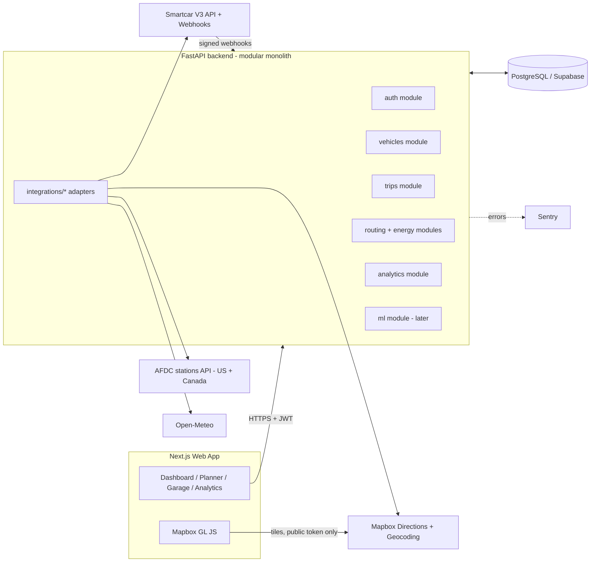

# Chargewise — Architecture

Status: **Draft (specification phase)** · Last updated: 2026-11-06

This document describes the shape of the system and why it is shaped that way. It is the technical counterpart to [`product-requirements.md`](product-requirements.md).

## 1. Technology decisions

| Layer | Choice | Why |
|---|---|---|
| Frontend | Next.js + TypeScript, React, Tailwind CSS, shadcn/ui, Mapbox GL JS | Mature routing/layouts, auth-friendly, production ecosystem. Used primarily as a frontend, not a backend-in-disguise. |
| Backend | Python 3, FastAPI, Pydantic | Shared language with ML tooling; strong typing; auto-generated OpenAPI. |
| Database | PostgreSQL via Supabase; SQLAlchemy + Alembic | Relational data for users, vehicles, telemetry, trips, predictions. PostGIS added only if geospatial queries get complex. |
| Authentication | Supabase Auth | Managed auth, JWTs verifiable by the FastAPI backend. |
| Vehicle integration | Smartcar API V3 + webhooks | V3 is the current, recommended version (V2 deprecating late 2026). See [`adr/0002-smartcar-v3-webhook-telemetry.md`](adr/0002-smartcar-v3-webhook-telemetry.md). |
| Maps / routing | Mapbox Directions + Geocoding / Search Box | Reliable driving routes and POI/address autocomplete. |
| Charging stations | AFDC Alternative Fuel Stations API (`developer.nlr.gov`, formerly NREL) for the US and Canada | Canadian stations come from Natural Resources Canada through the same API (`country=all`); verified in Phase 3 F0, see [`maps-stations-notes.md`](maps-stations-notes.md). |
| Weather | Open-Meteo (non-commercial) initially | Free tier is fine for a portfolio; re-evaluate before any commercial use. |
| Testing | pytest, Vitest + React Testing Library, Playwright | Covers backend, components, end-to-end UI. |
| ML | scikit-learn, XGBoost, pandas, NumPy | Introduced only after a deterministic baseline exists. |

Rationale for the biggest calls:

- **Next.js over "React + Vite"**: real production ecosystem; still used as a frontend, not a dumping ground for business logic.
- **Separate FastAPI backend over Next.js API routes**: lets the future React Native app reuse the same backend, and lets routing/ML live in Python without rewriting.
- **Modular monolith over microservices**: one deployable, module boundaries enforced by directory structure and provider adapters. Microservices would add operational cost with zero benefit at this stage. See [`adr/0001-nextjs-fastapi-modular-monolith.md`](adr/0001-nextjs-fastapi-modular-monolith.md).
- **Build our own charging-aware optimizer instead of waiting for Mapbox EV Routing**: Mapbox EV Routing is private preview; shipping the project cannot depend on vendor access, and the routing algorithm is the technical centerpiece of the portfolio. See [`adr/0003-own-charging-optimizer-over-mapbox-ev-routing.md`](adr/0003-own-charging-optimizer-over-mapbox-ev-routing.md).

## 2. System diagram



Key rules the diagram encodes:

- The browser talks to **one** backend: FastAPI. It never calls Smartcar, AFDC, or the Mapbox secret token directly.
- The browser may hit Mapbox tiles/search directly with the **public** Mapbox token (needed for Mapbox GL JS), but any Mapbox call that uses a secret token goes through the backend.
- All third-party APIs are reached through adapters in `services/api/app/integrations/`.

## 3. Module layout (modular monolith)

Backend code lives in one FastAPI application under `services/api/app/`, split into modules:

| Module | Responsibility |
|---|---|
| `auth` | Validate Supabase JWTs, enforce authorization, resolve the current user. |
| `users` | Profiles and preferences. |
| `vehicles` | Connected vehicles, specs, ownership, Garage endpoints. |
| `integrations/smartcar` | V3 authentication, data retrieval, webhook verification + ingestion. |
| `integrations/mapbox` | Geocoding, Directions, Search Box. |
| `integrations/stations` | Charging-station retrieval and normalization (AFDC, behind a provider interface so another source can be added). |
| `integrations/weather` | Weather forecast and historical lookups. |
| `energy` | Battery consumption and range prediction (deterministic model, then ML wrapper). |
| `routing` | Route feasibility and charging-stop optimization. |
| `trips` | Planned and completed trips, saved itineraries. |
| `analytics` | Consumption statistics and prediction-error reporting. |
| `ml` | Training pipelines and inference wrappers (added post-MVP). |

Rules:

- Modules depend **down**, never **across**: e.g. `routing` may call `energy` and `integrations/stations`, but `integrations/stations` must not import from `routing`.
- Every external vendor call lives behind an adapter interface. Swapping Mapbox or AFDC should mean adding a new adapter, not rewriting `routing`.
- No cross-module database queries. Each module owns its SQLAlchemy models.

## 4. Two separate identities

Chargewise authenticates two different things:

1. **The Chargewise user**, authenticated via Supabase Auth; identified by a Supabase user ID (`profiles.id`).
2. **The vehicle connection**, authorized by the vehicle owner via Smartcar Connect; identified by the Smartcar user ID (`sc-user-id`) and the per-vehicle Smartcar vehicle ID.

The connect flow:

1. User signs into Chargewise (Supabase JWT).
2. User selects **Add Vehicle** on the Garage page.
3. Backend (`POST /api/v1/vehicles/connect`) signs a 10-minute `state` (HS256 JWT with the Chargewise user ID, the validated `redirect_after` path and a nonce) and returns a Connect URL with `response_type=none` and `external_id = profiles.id`.
4. User authorizes vehicle access with Smartcar.
5. Smartcar redirects the browser to the web app's `/garage/connect/callback` (`SMARTCAR_REDIRECT_URI`) with `user_id`, `state` and `external_id`. There is no code to exchange: V3 uses one application token for every user.
6. The web app forwards that query to `POST /api/v1/vehicles/connect/complete` with the **signed-in user's** Supabase JWT. The backend verifies `state` and requires its user to be the caller. Connect has to finish where the user's session is: otherwise an attacker could start Connect on their own account, send the authorization URL to a victim, and receive the victim's car (both `state` and Smartcar's `externalId` would name the attacker).
7. Backend lists the Smartcar user's connections and only accepts active ones whose `externalId` equals the user in `state`; the redirect's `user_id` is unauthenticated and the application token can read any Smartcar user's connections. Per connection: a car already connected to this user is a duplicate; a disconnected (or leftover pending) row is reactivated; a car active on another Chargewise user is refused; otherwise a `vehicles` row (`connected`) and `vehicle_specs` (from the static catalog, or `NULL`s) are inserted. `supported_signals` comes from a best-effort signal read and is often `[]` right after Connect; F5/F6 recompute it when data arrives.
8. Backend returns `{ result, redirect_after }`; the web app redirects to `redirect_after` with `connect=success|already_connected|denied|error`, and the Garage shows a banner.
9. Webhook enrolment: vehicles are enrolled by the Smartcar Dashboard's auto-subscribe setting. Chargewise does not call the V3 subscribe API; revisit if the real-car check shows a newly connected vehicle isn't enrolled.

Verified V3 details live in [`smartcar-v3-notes.md`](smartcar-v3-notes.md).

## 5. Webhook ingestion rules

`POST /api/v1/webhooks/smartcar` is the only endpoint allowed to accept Smartcar-signed traffic. It must:

1. **Verify the signature**: `SC-Signature` is the hex HMAC-SHA256 of the raw body, keyed with the Application Management Token (`SMARTCAR_MANAGEMENT_TOKEN`). Reject on mismatch, and verify before answering a `VERIFY` challenge.
2. **Deduplicate** by the Smartcar event ID, per signal (`source`, `source_event_id`, `signal_code`); already-processed events return 200 without re-writing.
3. **Parse and validate** supported signals; unknown fields are stored verbatim in a raw JSON column for later inspection.
4. **Preserve** the provider `recorded_at` and the raw unit.
5. **Persist** a normalized `vehicle_telemetry` row and update the cached latest state on `vehicles`.
6. **Handle out-of-order** delivery: the "latest state" is always the row with the maximum `recorded_at`, never the maximum `received_at`.
7. **Return** HTTP 2xx only after the event has been accepted, so Smartcar can retry on 5xx.

Normalized internal representation (illustrative, not a Smartcar response):

```json
{
  "vehicle_id": "internal-vehicle-id",
  "recorded_at": "2026-11-06T19:00:00Z",
  "received_at": "2026-11-06T19:01:05Z",
  "source": "smartcar",
  "signals": {
    "soc_percent": 72,
    "odometer_km": 20082.5,
    "range_km": 296,
    "is_charging": false
  }
}
```

The UI always displays the reading's `recorded_at`. If it crosses the freshness threshold (initially 15 minutes, subject to Smartcar plan reality), the UI marks it stale and the Trip Planner asks the user to confirm starting SoC before computing a plan.

## 6. Routing algorithm

The MVP does not use machine learning. It uses a deterministic battery model plus a search over feasible charging-stop sequences.

### 6.1 Feasibility check

Let:
- \(B\) = usable battery capacity in kWh
- \(s_0\) = initial state of charge (fraction, 0..1)
- \(E\) = predicted driving energy consumption in kWh
- \(s_{\min}\) = minimum battery reserve (fraction)

Arrival SoC:
\[
s_{\text{arrival}} = s_0 - \frac{E}{B}
\]

A route is feasible without charging when:
\[
s_{\text{arrival}} \geq s_{\min}
\]

### 6.2 Baseline energy model

For a route split into segments of length \(d_i\) with estimated consumption \(c_i\):
\[
E = \sum_{i=1}^{n} d_i c_i
\]

Initially, \(c_i\) comes from a configured per-vehicle baseline (kWh/mi for the bZ). Later, \(c_i\) is modulated by speed, elevation, temperature, and (eventually) learned corrections. Until then, the model is explicit about **what it does not know**.

### 6.3 Charging-stop search (MVP)

1. Request one or more road routes from the Mapbox adapter.
2. Ask the stations adapter for chargers compatible with the vehicle's connectors near each route.
3. Estimate energy consumption between origin, candidate chargers, and destination.
4. Discard segments that would violate \(s_{\min}\).
5. Enumerate feasible charging sequences (bounded; MVP uses a small upper bound on number of stops).
6. For each stop, estimate charging time from required energy and the vehicle's charging curve.
7. Pick the plan minimizing total journey time.

Objective:
\[
\min \left( T_{\text{drive}} + T_{\text{charge}} + T_{\text{waiting}} \right)
\]

Waiting time is initially a user-set assumption or zero. Chargewise never fabricates real-time queue data.

### 6.4 Charging time model

Because charging power depends on SoC, charging time is modeled as:
\[
T_{\text{charge}} = \int_{s_{\text{start}}}^{s_{\text{target}}} \frac{B}{P(s)} \, ds
\]

where \(P(s)\) is the vehicle-specific charging power at SoC \(s\). MVP uses a piecewise-linear approximation stored on `vehicle_specs.charging_curve`.

### 6.5 Post-MVP upgrade (Phase 4 end or later)

Model the problem as a graph:
- Nodes: (charger, discretized SoC bucket) plus origin and destination.
- Edges: drive segments with energy cost, and charging actions with time cost.

Then run Dijkstra or A* to find a minimum-cost feasible itinerary. This is the route-engineering centerpiece of the portfolio.

### 6.6 Infeasibility

If no feasible plan exists, the planner returns an explicit infeasibility response with the limiting constraint (insufficient SoC, no compatible chargers in reach, reserve too high). It must never return a silent "route found" result for an infeasible journey.

## 7. Deployment

| Component | Service |
|---|---|
| Next.js frontend | Vercel |
| FastAPI backend | Render or Fly.io |
| Database + Auth | Supabase |
| Error monitoring | Sentry |
| CI/CD | GitHub Actions |
| ML model artifacts (later) | Versioned object storage (decide in Phase 5) |

Smartcar webhooks require a publicly reachable HTTPS endpoint. Local development uses a temporary HTTPS tunnel forwarding to FastAPI; the tunnel URL is registered as the dev webhook target.

Avoid, for the MVP: Kubernetes, distributed microservices, message queues. Add Redis + a background worker only when webhook or compute load clearly needs it.

### 7.1 Environments

- **local** — developer machine, tunneled webhooks, seeded fixtures.
- **preview / staging** — deployed on push to a PR; uses a separate Supabase project and Smartcar dev credentials.
- **production** — main branch; real Smartcar credentials; monitored.

### 7.2 Public demo mode vs private live mode

The deployed app runs in two modes gated by configuration:

- **Private live mode** for authorized users: real Smartcar data, real telemetry, real location history.
- **Public demo mode** for recruiters: clearly labeled simulated data, no real coordinates, no Smartcar credentials loaded. All demo records carry `is_simulated = true`.

The two modes **never** share records. Analytics and ML training sets exclude `is_simulated = true` by default.

## 8. Testing strategy

| Layer | Tests |
|---|---|
| FastAPI | `pytest` unit + integration; API contract tests against generated OpenAPI. |
| React components | Vitest + React Testing Library. |
| End-to-end UI | Playwright for the MVP demo flow. Runs the real API and web app against local Postgres and a small Supabase Auth stub (`apps/web/e2e/support/`); data is seeded by delivering a locally signed webhook, so no real Supabase or Smartcar is involved. |
| Database | Alembic migration round-trip tests; integration tests on a disposable Postgres. |
| Smartcar | Deterministic mock responses + signed webhook fixtures in [`fixtures/smartcar/`](../fixtures/smartcar/). |
| Routing | Covers every case in the acceptance matrix (see [`product-requirements.md`](product-requirements.md#9-acceptance-test-matrix)). |
| ML (post-MVP) | Data validation, baseline-vs-model regression tests, offline evaluation metrics. |

Rules:

- Default CI never hits the real Smartcar, Mapbox, AFDC, or Open-Meteo. Fixtures only.
- Live-API integration tests are in a separate, manually triggered workflow with its own credentials.
- An agent must not report "tests pass" without actually running the suite.

## 9. Observability

- **Logs:** structured JSON, one log line per external request including provider, endpoint, duration, status.
- **Traces (optional, later):** OpenTelemetry on the FastAPI side if latency debugging requires it.
- **Error reporting:** Sentry in deployed environments. Scrub user IDs and vehicle coordinates by default.
- **Metrics (manual, later):** request counts, planner latency, Smartcar webhook success rate.

## 10. Non-functional constraints

- Latency target for `POST /api/v1/routes/plan`: ~3 s for a trip under ~500 mi using the deterministic optimizer; document measured numbers in roadmap deliverables.
- Smartcar quota: assume a modest free-tier plan; cache the latest state in `vehicles` so Dashboard reads never require a live Smartcar call.
- Secrets live only in deployment-provider secret stores or `.env` files that are gitignored; the per-app `.env.example` files (`services/api/`, `apps/web/`) are the only committed templates.

## 11. Open architectural questions

Tracked explicitly so they don't get buried in PR threads:

- ~~**Canadian stations**~~ — resolved in Phase 3 F0: AFDC covers Canada with `country=all` ([`maps-stations-notes.md`](maps-stations-notes.md)).
- **Smartcar event frequency** — verify empirically on the real Toyota during Phase 2 before setting a Dashboard freshness threshold.
- **Weather provider** — confirm Open-Meteo license fits the usage before building on it.
- **Mapbox EV Routing** — stay on a self-built optimizer; revisit only if Mapbox EV Routing becomes GA with acceptable pricing.
- **Where ML runs** — same process as FastAPI, a separate worker, or a serverless function. Deferred to Phase 5.
