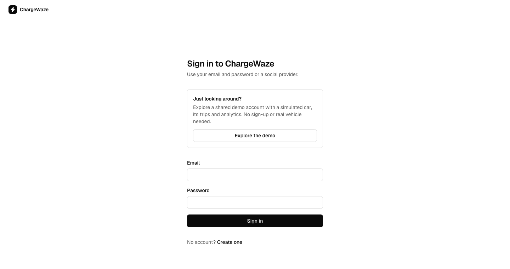
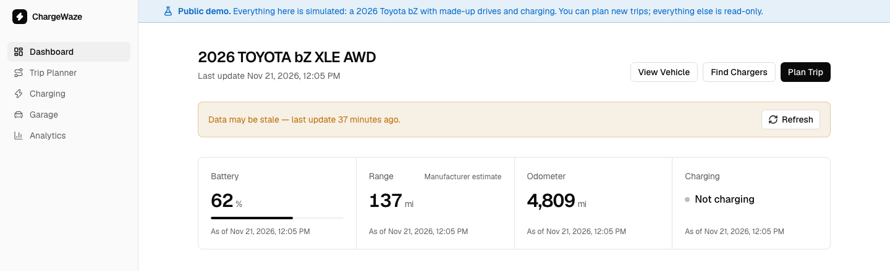
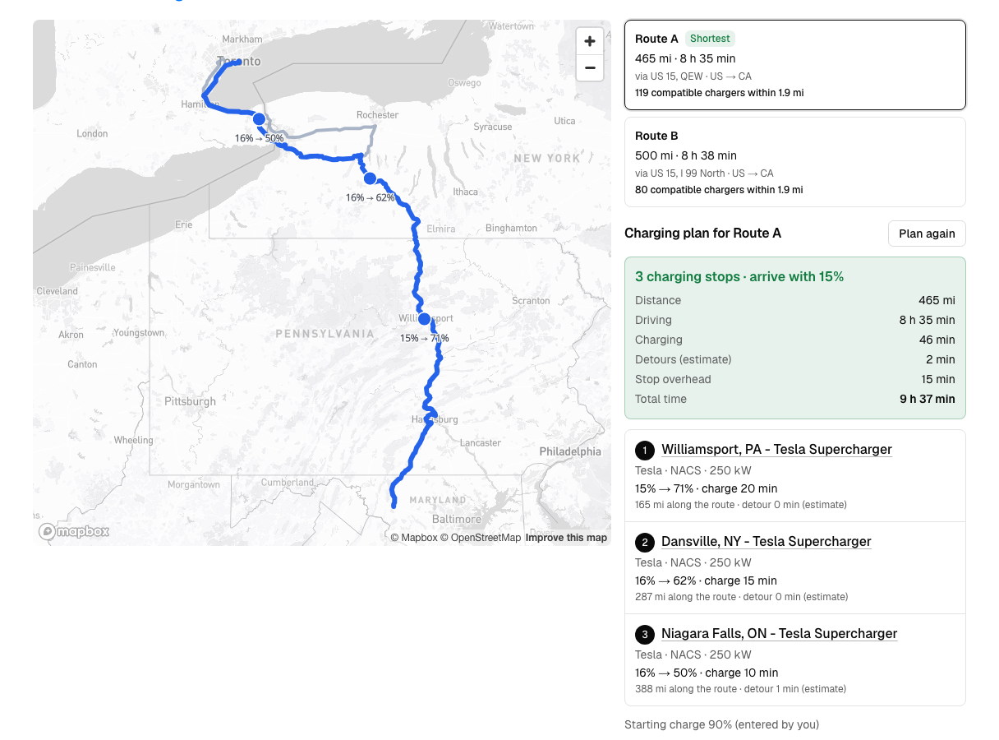
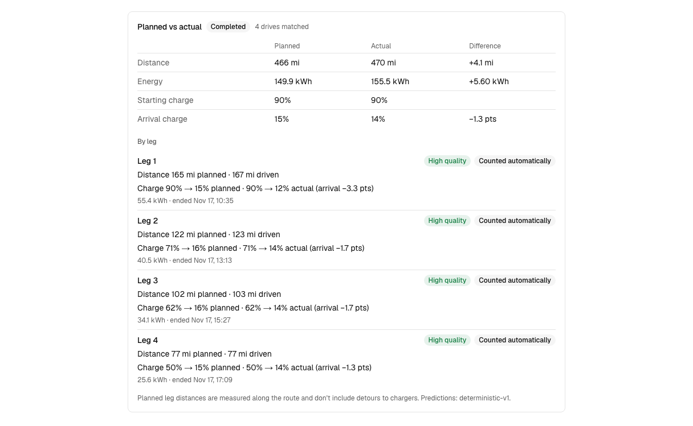
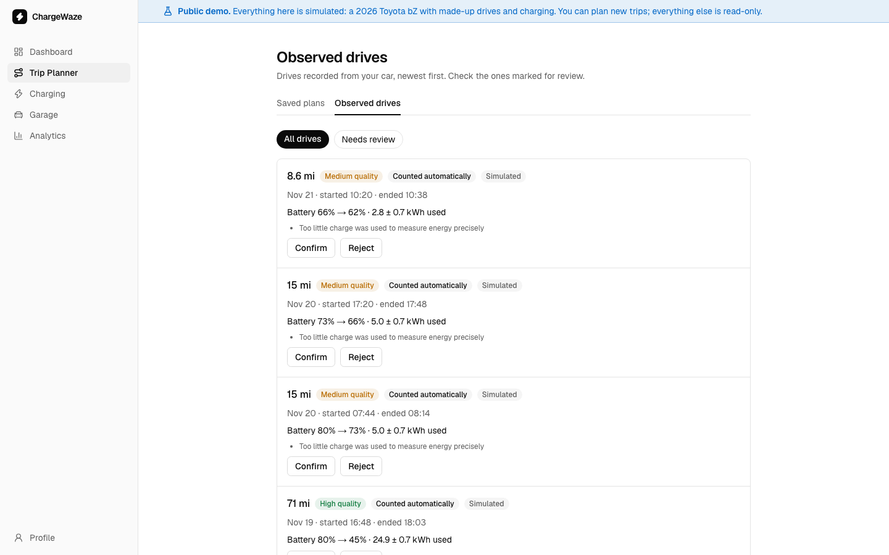
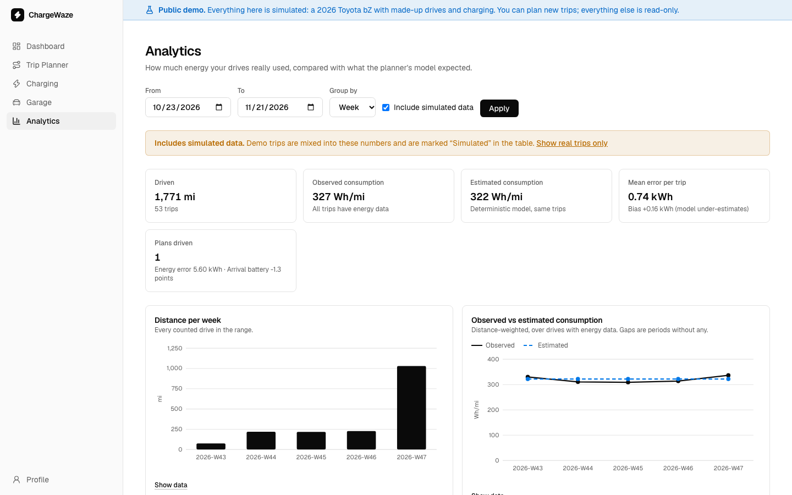

# ChargeWaze demo script

Status: **written against demo mode; the public demo URL is pending ([M-18](manual-test-log.md#m-18--public-demo-deployment-p6-f2))** · Last updated: 2026-11-21

This is what a recruiter or reviewer sees and clicks in the public demo, in about five minutes, and what each step shows about how ChargeWaze is built. It follows the check in [`deployment.md`](deployment.md) §13.2 step 6.

## Before you start

| | |
|---|---|
| **Demo URL** | *Pending M-18.* The demo is a separate deployment (its own Supabase project, Render service and Vercel project, [`deployment.md`](deployment.md) §13.2). Add its URL here and to the README once M-18 passes. |
| **Production URL** | [chargewaze.vercel.app](https://chargewaze.vercel.app). Sign-in is limited to an allowlist, so visitors can't use it. |
| **Account** | None needed. The demo's sign-in page has **Explore the demo**, which signs in to one shared, seeded account. |
| **Data** | Simulated: a 2026 Toyota bZ XLE AWD with about four weeks of drives and charging, written by [`seed_demo.py`](../services/api/scripts/seed_demo.py). Routes and stations come from recorded Mapbox and AFDC responses in `fixtures/`, so the road trip is real geography. Every page shows a "Public demo" banner. |
| **First load** | The API runs on Render's free plan and spins down when idle. If the first page takes a while, it's the API starting up. |

The figures below come from a local demo-mode run on 2026-11-21 (seed `--now` = that day). The seed is deterministic for a given `--now`, but a re-seed on another day shifts dates and some values.

## The walkthrough

### 1. Sign in (10 seconds)

Open the demo URL and click **Explore the demo**.

- **What you see:** the Dashboard, with a "Public demo" banner on every page.
- **What it shows:** Supabase Auth issues the session. The FastAPI backend verifies the JWT on every request and then runs the demo gate. That gate serves only simulated rows, refuses to start with Smartcar secrets, and answers `503` if the database ever holds a real vehicle ([`architecture.md`](architecture.md) §7.2).

### 2. Dashboard (20 seconds)

- **What you see:** the simulated bZ's battery (62 % in the local run), range, odometer and charging state. Each value has the time it was recorded, and an amber "Data may be stale" banner appears because the last reading is more than 15 minutes old.
- **What it shows:** telemetry is stored with the provider's `recorded_at`. The Dashboard reads the cached latest state and never calls Smartcar on a page load. Stale data is labeled, not hidden ([ADR 0002](adr/0002-smartcar-v3-webhook-telemetry.md)). In live mode, **Refresh** makes one rate-limited Smartcar read to fill missed webhooks ([ADR 0010](adr/0010-on-demand-vehicle-refresh.md)). Skip it in the demo: the API refuses it as read-only, and the page then says "Couldn't reach your car's data provider" (see step 7).

### 3. Plan a road trip (90 seconds)

Click **Plan Trip** (or **Trip Planner** in the sidebar).

1. In **From**, type `Tesla Supercharger Frederick` and pick the suggestion. In **To**, type `Toronto` and pick it.
2. The map draws two routes. In the local run, Route A was 465 mi with 119 compatible chargers within 1.9 mi, and Route B was 500 mi with 80. Connector filters default to the car's connectors.
3. Click **Plan charging stops**. Because the car's reading is stale, the planner asks for a starting charge instead of guessing. Enter `90` and click **Plan with this charge**.
4. **What you see:** 3 charging stops (Williamsport PA, Dansville NY, Niagara Falls ON), each with its arrival and departure charge and charging time. Arrival is 15 %, and the total is 9 h 37 min (8 h 35 min driving, 46 min charging, 2 min detours, 15 min stop overhead). The map marks each stop with its charge window.
5. Optional: open **Re-plan with different preferences**, set Reserve to `50` and Charge to `55`, and click **Re-plan**. The result is an explicit **Not feasible: Reserve can't be kept**. It names the problem stretch (red on the map) and the charge it would need, instead of drawing a route anyway.

- **What it shows:** ChargeWaze's own optimizer ([ADR 0003](adr/0003-own-charging-optimizer-over-mapbox-ev-routing.md), [ADR 0008](adr/0008-route-ordered-dp-charging-optimizer.md)). It is a dynamic program over (charger, departure charge) in route order. It minimizes charging, detour and stop time, and keeps the reserve at every arrival. The plan's **Assumptions** list what the deterministic energy model uses and what it ignores (temperature, speed, elevation, traffic). On the same recorded route, a whole plan request took 241–272 ms on fixtures (2026-11-19, [roadmap](development-roadmap.md) Phase 4).
- Planning is the one write the demo allows, so the new plan is stored, marked simulated.

### 4. Planned vs actual (60 seconds)

Click **Saved trips**, then **Frederick, MD → Toronto, ON**.

- **What you see:** the saved plan, and a **Planned vs actual** panel marked Completed with 4 drives matched. In the local run the drive used 155.5 kWh against 149.9 kWh planned (+5.60 kWh) and arrived at 14 % against 15 % planned (−1.3 points). Each leg is compared with its own stop and carries a quality badge.
- **What it shows:** nobody entered this trip by hand. The simulated car "drove" the plan, and the real Phase 5 pipeline built the result: drive inference from telemetry gaps, then matching to the plan, then backtests ([ADR 0009](adr/0009-in-process-post-ingest-hook-for-trip-inference.md)).

### 5. Observed drives (30 seconds)

Go back and open the **Observed drives** tab.

- **What you see:** every drive inferred from four weeks of telemetry (62 in the local run: 16 high, 37 medium, 9 low quality). Each has its distance, battery change and energy with an uncertainty, plus a quality badge with the reason ("Too little charge was used to measure energy precisely"). **Needs review** filters the low-quality ones.
- **What it shows:** SoC-inferred energy is an estimate, and the app says how good each estimate is instead of presenting every number as exact.

### 6. Analytics (45 seconds)

Click **Analytics**.

- **What you see:** an amber "Includes simulated data" notice (the demo includes it by default). Then summary cards: distance and trips, observed vs estimated consumption (Wh/mi), mean error per trip, and plans driven. Below them are distance per week and observed vs estimated consumption charts. **Show real trips only** leaves simulated data out; in the demo that says the 62 simulated trips are left out and shows no trips. The CSV link exports the same rows the page shows.
- **What it shows:** provenance. Every row carries `is_simulated` and a source, and analytics only mix simulated data in when asked, with a label.

### 7. Read-only demo (15 seconds, optional)

Back on the saved trip, click **Delete** and confirm.

- **What happens:** the trip stays. The API answers `403` with "The public demo is read-only. You can still plan trips." (`details.reason = DEMO_READ_ONLY`), because every visitor shares one account.
- **Known gap:** the web app doesn't show that message yet. Delete shows its generic "Couldn't delete the trip. Please try again.", and Dashboard **Refresh** shows "Couldn't reach your car's data provider. Please try again later." The fix is a follow-up to P6-F2: map `DEMO_READ_ONLY` to the API's message in the web write actions. Until then, say out loud that the demo is read-only.

## Talking points

- **One backend, adapters for every provider.** The browser only talks to FastAPI. Smartcar, Mapbox (secret token), AFDC and Supabase admin calls all go through `services/api/app/integrations/` ([ADR 0001](adr/0001-nextjs-fastapi-modular-monolith.md)).
- **Event-driven telemetry.** Signed Smartcar webhooks, verified before anything is stored, deduplicated by event ID, ordered by `recorded_at`.
- **Honest numbers.** No fabricated telemetry or charger availability. Infeasible trips say why. Energy estimates carry uncertainty and quality flags. The deterministic model stays as the baseline any future ML model must beat ([ADR 0004](adr/0004-deterministic-energy-baseline-before-ml.md)).
- **Privacy.** Sentry events are scrubbed of user IDs, coordinates and route geometry. Accounts can be deleted, which revokes Smartcar access. Real and simulated data never share a deployment.
- **Tested.** pytest, Vitest and Playwright run in CI; the Playwright suite drives the real API and web app against recorded provider responses. Production has a deploy workflow and a smoke workflow that runs every six hours.

## Pending

| Item | Closes with |
|---|---|
| Public demo URL in this script and the README | [M-18](manual-test-log.md#m-18--public-demo-deployment-p6-f2), [`deployment.md`](deployment.md) §13.2 steps 1–6 |
| The same walkthrough checked on the deployed demo (this script was checked on a local demo-mode run) | M-18 step 6 |
| Real-car data, which only production shows | M-01, M-02, M-11 in [`manual-test-log.md`](manual-test-log.md) |
| "The public demo is read-only" message in the web app (Delete, Refresh and other writes show generic errors today) | Follow-up to P6-F2 (web write actions) |
